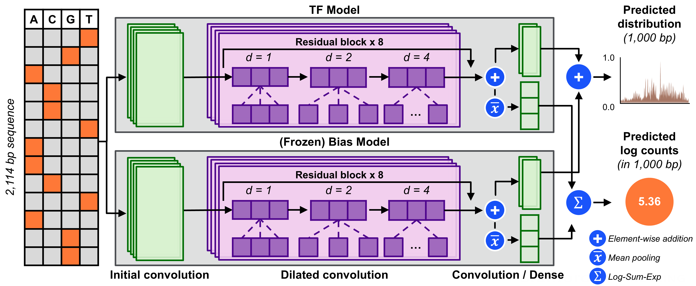

# ChromBPNet

Bias-factorized, base-resolution deep learning models of chromatin accessibility. 
ChromBPNet learns to predict base-resolution ATAC-seq or DNase-seq coverage from DNA sequence, while explicitly factoring out the sequence bias of the assay enzyme (Tn5 or DNase I). 
The bias-free model can then be interpreted to recover cis-regulatory sequence syntax, transcription factor footprints, and the effect of regulatory variants.

> [!NOTE]
> This repo is a refactored version of the [original ChromBPNet model](https://github.com/kundajelab/chrombpnet/). The refactored implementation is more efficient, runs on modern hardware and packages (including PyTorch, TensorFlow, and JAX), and is near-perfectly reproducible of the original model, including user arguments. We highly recommend using the refactored version.



## Table of contents

- [Installation](#installation)
- [Quick Start](#quick-start)
  1. [Training a bias model](#1-training-a-bias-model)
  2. [Training a bias-factorized ChromBPNet model](#2-training-a-bias-factorized-chrombpnet-model)
  3. [Other command lines](#3-other-command-lines)
- [Optimizations](#optimizations)
- [Reproducibility](#reproducibility)
- [Python API](#python-api)
- Additional information:
  - [Engines and environments](envs/README.md),
  - [Accessibility signal conventions](chrombpnet/helpers/preprocessing/README.md#accessibility-signal-conventions),
  - [Testing](tests/README.md)

## Installation

Each engine has its own conda environment, because their frameworks cannot
share one. Create the ones you need from the repository root:

| Engine | Create the environment | Then | Python and framework |
|---|---|---|---|
| PyTorch (default) | `conda env create -f envs/chrombpnet-pytorch.yml` | `conda activate chrombpnet-pytorch` | Python 3.12, PyTorch 2.14 |
| TensorFlow | `conda env create -f envs/chrombpnet-tensorflow.yml` | `conda activate chrombpnet-tensorflow` | Python 3.12, TensorFlow 2.21 (tf-keras) |
| JAX | `conda env create -f envs/chrombpnet-jax.yml` | `conda activate chrombpnet-jax` | Python 3.12, JAX 0.11 (Keras 3.15) |

- Each file installs this package in editable mode with its engine's extra,
  plus the command-line tools preprocessing uses (`bedtools`, `samtools`,
  `bedGraphToBigWig`), MEME's `tomtom` and the Pango/Cairo stack for the PDF
  reports.
- GPUs need a CUDA 12 driver (525 or newer), and the framework wheels need
  glibc 2.28 or newer: on older systems (e.g. CentOS 7), run in a container.
  Blackwell GPUs need a different PyTorch build (see `envs/README.md`).
- Pick the engine with `--engine` (the checkpoint suffix decides when it is
  omitted) and the device with `--device cpu`, `cuda` or e.g. `cuda:1`.
  [`envs/README.md`](envs/README.md) describes each engine, its GPU
  libraries, and what differs between them.
- The motif reports use TF-MoDISco and match motifs with MEME's `tomtom`;
  `--tomtom-lite` uses TOMTOM-lite (memelite) instead, with uncorrected
  p-values. TOMTOM-lite needs TF-MoDISco 2.5 or later, which every
  environment here has.

## Quick Start

Both steps take the same inputs, described under step 1. A bias model
generally transfers between samples of the same assay, so step 1 can be
skipped when you already have one.

### 1. Training a bias model

A bias model is trained on background regions only, so it can learn the
enzyme's sequence preference without learning biology:

```bash
chrombpnet bias pipeline \
  -ibam /path/to/input.bam \
  -d ATAC \
  -g /path/to/hg38.fa \
  -c /path/to/hg38.chrom.sizes \
  -p /path/to/peaks.bed \
  -n /path/to/nonpeaks.bed \
  -fl /path/to/fold_0.json \
  -b 0.5 \
  -o /path/to/bias/dir/
```

Here `-b` is the bias threshold factor, not a model path: non-peak regions
whose counts exceed `-b x` the 1st-percentile peak count are dropped, so the
model never sees background that looks like signal. Start at `0.5` for ATAC
and `0.8` for DNase. The trained model lands at `models/bias.pt` and is what
you pass to `chrombpnet pipeline -b` in step 2.

#### Input format

- `-ibam` / `-ifrag` / `-itag` / `-ibw`: filtered reads, as BAM, fragment file
  or tagAlign, or in their place a bigwig that `chrombpnet prep bigwig` made
  from them (see [Making the bigwig once](#making-the-bigwig-once)). Exactly
  one is required. Example files:
  [bam](https://storage.googleapis.com/chrombpnet_data/input_files/ENCSR868FGK_merged.bam),
  [fragment](https://storage.googleapis.com/chrombpnet_data/input_files/example.fragments.tsv),
  [tagalign](https://storage.googleapis.com/chrombpnet_data/input_files/example.tagAlign).
  The enzyme shift is estimated from the reads; you do not supply it.
  - For DNase-seq with `-ibw`, the model predicts cuts in the convention the
    bigwig records. Previous-generation ChromBPNet models effectively
    predicted a `both-half` convention, even when given a bigwig with a left
    or right shift convention.
- `-d`: assay type, `ATAC` or `DNASE`.
- `-g`: reference genome FASTA, e.g.
  [hg38.fa](https://storage.googleapis.com/chrombpnet_data/input_files/hg38.genome.fa).
- `-c`: two-column chromosome-sizes file, e.g.
  [hg38.chrom.sizes](https://storage.googleapis.com/chrombpnet_data/input_files/hg38.chrom.sizes).
- `-p`: peaks, in 10-column narrowPeak format. Only `chr`, `start`, `end` and
  the summit offset (column 10) are used; every region is centred on
  `start + summit`. Example:
  [peaks.bed](https://storage.googleapis.com/chrombpnet_data/input_files/ENCSR868FGK_relaxed_peaks_no_blacklist.bed).
- `-n`: non-peak background regions, same 10-column format. Generate your own
  with `chrombpnet prep nonpeaks` (step 3). Example:
  [nonpeaks.bed](https://storage.googleapis.com/chrombpnet_data/input_files/ENCSR868FGK_nonpeaks_no_blacklist.bed).
- `-fl`: JSON naming the train/valid/test chromosome split. Generate one with
  `chrombpnet prep splits`, or use the published
  [five-fold splits](https://zenodo.org/records/7443683/files/folds.zip?download=1).
- `-o`: output directory.

Optional flags worth knowing: `-fp` prefixes every output filename, `-bs` sets
the training batch size, `-ibs` the contribution-scoring batch size (defaults
to `-bs / 4`, because attribution needs about four times the GPU memory of a
training step), `--dnase-convention` and `--data-aug` set how DNase cuts are
recorded and which examples are reverse complemented (see
[accessibility signal conventions](chrombpnet/helpers/preprocessing/README.md#accessibility-signal-conventions)),
and `--reproducibility` / `--reproducibility-max` hold more of the run fixed
(see [Reproducibility](#reproducibility)), and `--contribs-profile-stopgrad`
weights the profile contribution target by the input's own predicted profile
instead of chrombpnet 1.x's midpoint (see
[engines](envs/README.md#how-the-engines-plug-in)).

For guidance on preparing reads and peaks, see the
[preprocessing notes](https://github.com/kundajelab/chrombpnet/wiki/Preprocessing).

### 2. Training a bias-factorized ChromBPNet model

With a bias model in hand:

```bash
# -ibam takes a BAM; use -ifrag for a fragment file or -itag for a tagAlign.
chrombpnet pipeline \
  -ibam /path/to/input.bam \
  -d ATAC \
  -g /path/to/hg38.fa \
  -c /path/to/hg38.chrom.sizes \
  -p /path/to/peaks.bed \
  -n /path/to/nonpeaks.bed \
  -fl /path/to/fold_0.json \
  -b /path/to/bias.pt \
  -o /path/to/output/dir/
```

The inputs are step 1's, except that `-b` is now the bias model checkpoint.
Use `chrombpnet train` instead of `pipeline` to stop after training and its
report, skipping evaluation, contribution scoring and motif discovery.

#### Making the bigwig once

Given reads, every training command first converts them into a shifted,
unstranded bigwig (`auxiliary/data_unstranded.bw`), so steps 1 and 2 each
build the same one. `chrombpnet prep bigwig` does this conversion on its own,
and `-ibw` passes the result to any of `bias pipeline`, `bias train`,
`pipeline` and `train` in place of `-ibam`/`-ifrag`/`-itag`:

```bash
chrombpnet prep bigwig -ibam /path/to/input.bam -d ATAC \
  -g /path/to/hg38.fa -c /path/to/hg38.chrom.sizes -op /path/to/data
# writes /path/to/data_unstranded.bw
chrombpnet bias pipeline -ibw /path/to/data_unstranded.bw -d ATAC ... -b 0.5 -o /path/to/bias/dir/
chrombpnet pipeline -ibw /path/to/data_unstranded.bw -d ATAC ... -b /path/to/bias.pt -o /path/to/output/dir/
```

A run given `-ibw` trains exactly what a run given the reads trains. It skips
only the conversion, and still draws the shift QC (`evaluation/bw_shift_qc.png`)
from the bigwig. `prep bigwig` estimates the enzyme shift like the training
commands, or takes a known one with `-ps`/`-ms`.

The bigwig must follow this package's conventions, which the training
commands cannot check; the shift QC is the evidence. For DNase, give the
training commands the same `--dnase-convention` the bigwig was made with,
because reverse-complement augmentation depends on it. The default,
`both-half`, does not describe a DNase bigwig from chrombpnet 1.x, which
records each cut on one base as `right` does: give `--dnase-convention right`
with one, or `right-deprecated` to reproduce 1.x training exactly.

#### Output format

`chrombpnet train` writes:

```text
models/
    chrombpnet.pt                  combined model
    chrombpnet_nobias.pt           bias-corrected accessibility model
    bias_model_scaled.pt           input bias model, rescaled to this sample
logs/
    chrombpnet.log                 loss per epoch
    chrombpnet.log.batch           loss per batch per epoch
    chrombpnet.args.json           every argument the run was given
    chrombpnet_model_params.tsv
    chrombpnet_data_params.tsv
auxiliary/
    data_unstranded.bw             shifted coverage built from the reads
    filtered.peaks.bed
    filtered.nonpeaks.bed
evaluation/
    overall_report.html
    overall_report.pdf
    bw_shift_qc.png                enzyme-shift check; should look like the motif
    epoch_loss.png
    bias_metrics.json              sanity check that the bias model alone
    bias_predictions.h5            does not explain the peaks
    bias_only_peaks.counts_pearsonr.png
    bias_only_peaks.profile_jsd.png
```

`chrombpnet pipeline` runs all of the above and then adds:

```text
auxiliary/
    motif_to_pwm.tsv               the motifs that were footprinted
    30K_subsample_peaks.bed        peaks used for contribution scoring
    chrombpnet_nobias_footprints.h5
    interpret_subsample/
        chrombpnet_nobias.interpreted_regions.bed   the regions scored, in row order
        chrombpnet_nobias.counts_scores.h5          DeepSHAP scores, counts head
        chrombpnet_nobias.profile_scores.h5         DeepSHAP scores, profile head
        modisco_results_profile_scores.h5
evaluation/
    chrombpnet_metrics.json        the headline count and profile metrics
    chrombpnet_predictions.h5
    chrombpnet_only_peaks.counts_pearsonr.png
    chrombpnet_only_peaks.profile_jsd.png
    chrombpnet_nobias.<motif>.footprint.png    one per motif in the table
    chrombpnet_nobias_max_bias_response.txt
    modisco_profile/               motif report (HTML, PNG logos, TSV)
    chrombpnet_nobias_profile.pdf
```

Read `evaluation/overall_report.html` first: it collects the shift QC image,
the loss curve, the count and profile metrics, the marginal footprints and the
discovered motifs into one page. The profile metric `median_jsd` is the median
Jensen-Shannon distance, in base 2, between observed and predicted profiles:
0 is identical, 1 is disjoint. (The original package reported it in base e;
divide those values by sqrt(ln 2) to compare.)

`evaluation/chrombpnet_metrics.json` (with the optional filename prefix) also
holds `profile_metrics.peaks.median_pearsonr`: the median over test peaks of
the Pearson R, across bases within each peak, between observed counts and
predicted profile probabilities, without smoothing or log transforms.
Constant or non-finite profiles have undefined R and are excluded; the value
is `null` if no peak has a defined correlation. The same metric is in every
evaluation JSON:

- ChromBPNet `pipeline`/`qc`: `evaluation/[prefix_]chrombpnet_metrics.json`.
- Bias `pipeline`/`qc`: `evaluation/[prefix_]bias_metrics.json`; the main
  pipeline's input bias check uses unprefixed `evaluation/bias_metrics.json`.
- Standalone `predict`: `<output-prefix>_metrics.json`.
- `pred_bw` with `--bigwig`: `<output-prefix>_<model>_metrics.json`, where
  `<model>` is `chrombpnet`, `chrombpnet_nobias`, or `bias`, for supplied
  models; there it is `profile_metrics.regions.median_pearsonr`, across the
  evaluated regions.

The HTML/PDF reports do not show it.

### 3. Other command lines

```text
chrombpnet pipeline          train a bias-factorized model, then evaluate it
chrombpnet train             train only, then write the training report
chrombpnet qc                evaluate an already-trained model
chrombpnet bias pipeline     train a bias model, then evaluate it
chrombpnet bias train        train a bias model only
chrombpnet bias qc           evaluate an already-trained bias model
chrombpnet prep nonpeaks     GC-matched background regions from peaks
chrombpnet prep splits       chromosome train/valid/test split JSON
chrombpnet prep bigwig       shifted, unstranded bigwig from reads (for -ibw)
chrombpnet predict           score one model on a fold's test split
chrombpnet pred_bw           prediction bigwigs (and metrics, given -bw)
chrombpnet contribs_bw       contribution-score bigwigs
chrombpnet modisco_motifs    motif discovery from contribution scores
chrombpnet footprints        marginal footprints for given motifs
chrombpnet export            a JAX-engine model in the original's .h5 layout
chrombpnet distill           one bias-free model from several (PyTorch engine)
```

Run `chrombpnet <command> --help` for the full argument list.

`pipeline`, `qc`, `bias pipeline` and `bias qc` end with TF-MoDISco motif
reports, built from contribution scores on a `--seed` sample of the peaks.
Four options control them, all off by default:

| option | default |
|---|---|
| `--interpret-subsample N` | 30 000 peaks scored (all of them if there are fewer) |
| `--modisco-max-seqlets N` | 50 000 seqlets per positive/negative pattern group |
| `--modisco-window BP` | 500 bp centred window; even, at most the input length |
| `--tomtom-lite` | match motifs with TOMTOM-lite instead of MEME's `tomtom` (also on `modisco_motifs`) |

`modisco_motifs` takes its own `--max-seqlets` and `--window`.

#### Experimental: PyTorch engine only

Three opt-in changes, refused by the other engines. Without them nothing
changes, `args.json` and checkpoints included.

- `bias pipeline` / `bias train --bias-profile-only`: a bias model with a
  profile head and no counts head, trained on the profile loss alone. A
  ChromBPNet model trained on it adds the bias to the profile only and takes
  its counts from the accessibility model alone, so `chrombpnet_nobias`'s
  counts are no longer bias-corrected. `pipeline` and `train` read this off
  the checkpoint; the bias rescaling and the peak-count check are skipped,
  and the bias reports have profile metrics and motifs only.
- `pipeline` / `train --model-selection pearsonr-jsd`: keep the epoch, and
  stop early, on the validation peaks' counts Pearson r + (1 - median profile
  JSD), computed as the test metrics are, instead of the validation loss.
  The training loss is unchanged. `logs/chrombpnet.log` gains
  `val_counts_pearsonr`, `val_profile_median_jsd` and `val_selection_score`.
- `distill -t <chrombpnet_nobias.pt ...>`: train one bias-free student on
  several models' averaged predictions -- the mean of their profile
  probabilities times the mean of their predicted totals, and the mean of
  their log counts -- with ChromBPNet's own loss, on the same jittered and
  reverse-complemented batches the teachers see. It takes the training
  commands' data arguments and writes a `chrombpnet_nobias` checkpoint,
  `<prefix>.pt`, which `predict`, `contribs_bw` and `footprints` read as they
  read a trained model's. `--all-chromosomes` trains on every chromosome of
  the fold file for exactly `--epochs` epochs.

## Optimizations

### Compared with original ChromBPNet ([kundajelab/chrombpnet](https://github.com/kundajelab/chrombpnet)):

- **Three engines instead of one.** PyTorch (default), TensorFlow (with
  tf-keras, the Keras 2 API) and JAX (with Keras 3), all behind one shared,
  framework-neutral pipeline. Contribution scoring is batched over
  (sequence, reference) pairs in PyTorch, and computes both heads in one
  jitted pass in JAX, where the original explains one example at a time. See
  [`envs/README.md`](envs/README.md).
- **Non-peak selection** (`prep nonpeaks`): candidates are compact numeric
  arrays, shuffled once per fold, sorted by GC bin and consumed without
  replacement, with a binary search for the nearest non-empty bin. The
  original walked the GC bins at random per region in Python, and could loop
  forever once the matching bins ran out; this fails with an error instead.
- **Sequence windows** are read through a memory map of the FASTA, one
  gather per chromosome, instead of one `pyfaidx` slice per region, and
  one-hot encoded through a 256-entry lookup table instead of a sort.
- **Profile metrics** (JSD and its bounds) are computed for all regions at
  once instead of in a per-region loop, with identical values and the same
  random stream.
- **Prediction** casts and transposes each batch as it is needed into a
  preallocated output, instead of converting the whole input up front, and
  runs under `torch.inference_mode`.
- **`pred_bw`** featurizes the regions and reads the observed bigwig once for
  all its models, writes each model's bigwig and metrics in a worker process
  while the next model predicts, and builds the bigwig writer's arguments as
  numpy arrays.
- **BigWigs are written as fixed-step sections**: the same values, faster to
  write and smaller, so their bytes differ from the original's.
- **HDF5 outputs** are gzip level 9 behind the byte-shuffle filter (about
  1.2x smaller than the original's level 4), with large datasets' chunks
  compressed on a thread pool.
- **Start-up and shutdown**: heavy imports are started in the background, and
  the CLI exits without interpreter teardown once every output is verified
  and synced to disk.
- **Fused Triton forward** (`--predict-fused-kernel`, optional; on `pred_bw`,
  `footprints`, `qc` and `bias qc`): fp32-exact kernels in place of the
  eager TF32 convolutions, so predictions move by about 1e-5 (closer to an
  fp64 reference). On any CUDA GPU: the kit's measured tile on H100/H200,
  L40S and A100, one chosen from the GPU's shared memory elsewhere (checked
  against the default forward first). It buys accuracy, not speed: on an
  H200 and an L40S it was slower end to end. Not on `contribs_bw`, whose
  DeepLIFT needs autograd and hooks a fused kernel cannot provide.

The memory-mapped reads, the lookup-table one-hot, the vectorized metrics,
the worker-process writer, the background imports, the fast exit, the
threaded HDF5 compression and the Triton forward are adapted from the
[ChromBPNet optimization kit](https://github.com/anthropics/uplifting-biomolecular-modeling/tree/main/chrombpnet)
(Apache-2.0); the rest were written here. The CHANGELOG records each one.

## Reproducibility

### Compared with original ChromBPNet ([kundajelab/chrombpnet](https://github.com/kundajelab/chrombpnet)):

| Flag | Effect |
|---|---|
| `--reproducibility` | a pinned example schedule: jitter, reverse complements and negative subsamples come from a stream seeded by `--seed` and shared by every engine instead of the global RNG, epoch-start shuffling is off, and the validation set stops being re-cropped each epoch |
| `--reproducibility-max` | `--reproducibility` plus identical initial weight arrays in every engine, a replayable augmentation schedule, deterministic kernels, TF32 disabled and scalar Adam dispatch |

Two runs with the same flags and `--seed` draw the same examples in the same
order: the data pipeline is seeded before the model is built, and cuDNN
autotuning is left at its default (off), so kernel selection does not vary
between runs. On the CPU that makes their checkpoints, logs and metrics
identical; on a GPU, convolution kernels may still accumulate in a different
order unless `--reproducibility-max` asks for deterministic ones.

`--reproducibility-max` goes further and *requires* determinism rather than
relying on it: deterministic algorithms in PyTorch (with TF32 off for both
cuDNN and cuBLAS matmuls), `enable_op_determinism` in TensorFlow, and XLA's
deterministic GPU kernels in JAX. That costs throughput, and on CUDA PyTorch
additionally demands `CUBLAS_WORKSPACE_CONFIG=:4096:8` in the environment
before it will allow deterministic cuBLAS reductions -- the package does not
set this for you.

Preprocessing is seeded too: the enzyme shift is estimated from a sample of
2 x `--num-samples` reads (20 000 by default) drawn with `--seed`, which
`prep bigwig` also takes.

### Randomized seeds

Every command that draws anything at random takes `-s/--seed` (default 1234)
and draws all of it from that one seed:

| Command | What `--seed` draws |
|---|---|
| `pipeline`, `train`, `bias pipeline`, `bias train` | training (initial weights, batch order, jitter, reverse complements, negatives), the shift-estimation read sample, and in the pipelines the `qc` draws below |
| `qc`, `bias qc` | the test set's nonpeaks, the profile-metrics shuffle, the contribution-score peak subsample, DeepSHAP's references |
| `predict`, `pred_bw` | the profile-metrics shuffle; `predict` also the test set's nonpeaks |
| `contribs_bw` | DeepSHAP's references |
| `prep nonpeaks`, `prep bigwig` | the GC-matched negatives; the shift-estimation read sample |

`prep splits`, `footprints` and `export` draw nothing at random. Two notes:

- **TF-MoDISco seeds itself.** modisco-lite takes no seed, so `--seed`
  reaches the motifs only through the contribution scores they are built
  from.
- **chrombpnet 1.x drew the training negatives with a fixed seed of 1**;
  `--seed 1` makes the same draw. That gives 1.x's exact negatives where the
  outlier thresholds (an unseeded draw in 1.x) come out the same, as on
  ENCSR868FGK fold 0, but never 1.x's `counts_loss_weight`, which that
  unseeded draw sets. It also moves every other draw to 1, where 1.x used
  1234.

## Python API

```python
import torch
from chrombpnet import BiasModel, ChromBPNet, ModelConfig, load_model, save_model

config = ModelConfig(
    input_length=2114,
    output_length=1000,
    filters=512,
    n_dilation_layers=8,
    counts_loss_weight=1.0,
)
bias = BiasModel(ModelConfig(2114, 1000, filters=128, n_dilation_layers=4))
model = ChromBPNet(config, bias)

# Native tensor layout is NCL: batch, A/C/G/T channels, sequence length.
profile_logits, logcounts = model(torch.zeros(2, 4, 2114))

save_model(model, "chrombpnet.pt")
model = load_model("chrombpnet.pt")
```

The model has two heads: `profile_logits` over `output_length` positions, and a
single `logcounts` value per region, which is `log(1 + total counts)`. The
bias branch is frozen and stays in eval mode.

Historical scripts and paper-analysis assets that the CLI does not reach are
isolated under [`legacy/`](legacy/README.md). They are kept for provenance and
are not installed with the package.

## Publications

The original ChromBPNet paper and codebase can be found here:
- Paper (bioRxiv): [ChromBPNet: bias factorized, base-resolution deep learning models of chromatin accessibility reveal cis-regulatory sequence syntax, transcription factor footprints and regulatory variants](https://www.biorxiv.org/content/10.1101/2024.12.25.630221v4)
- Codebase (Github): [Bias factorized, base-resolution deep learning models of chromatin accessibility (kundajelab/chrombpnet)](https://github.com/kundajelab/chrombpnet):
- Citation:
```
@article {Pampari2024.12.25.630221,
	author = {Pampari, Anusri and Shcherbina, Anna and Kvon, Evgeny and Kosicki, Michael and Nair, Surag and Kundu, Soumya and Kathiria, Arwa S. and Risca, Viviana I. and Kuningas, Kristiina and Alasoo, Kaur and Greenleaf, William James and Pennacchio, Len A. and Kundaje, Anshul},
	title = {ChromBPNet: bias factorized, base-resolution deep learning models of chromatin accessibility reveal cis-regulatory sequence syntax, transcription factor footprints and regulatory variants},
	elocation-id = {2024.12.25.630221},
	year = {2024},
	doi = {10.1101/2024.12.25.630221},
	publisher = {Cold Spring Harbor Laboratory},
	URL = {https://www.biorxiv.org/content/early/2024/12/25/2024.12.25.630221},
	eprint = {https://www.biorxiv.org/content/early/2024/12/25/2024.12.25.630221.full.pdf},
	journal = {bioRxiv}
}
```